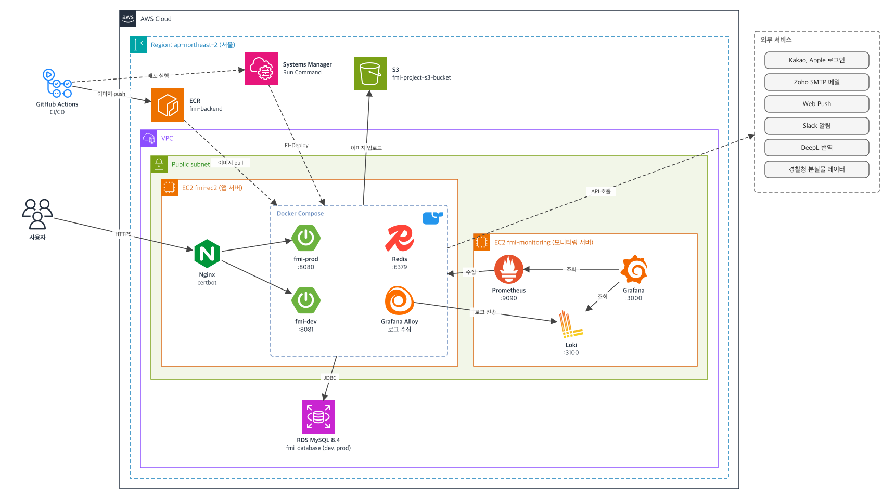
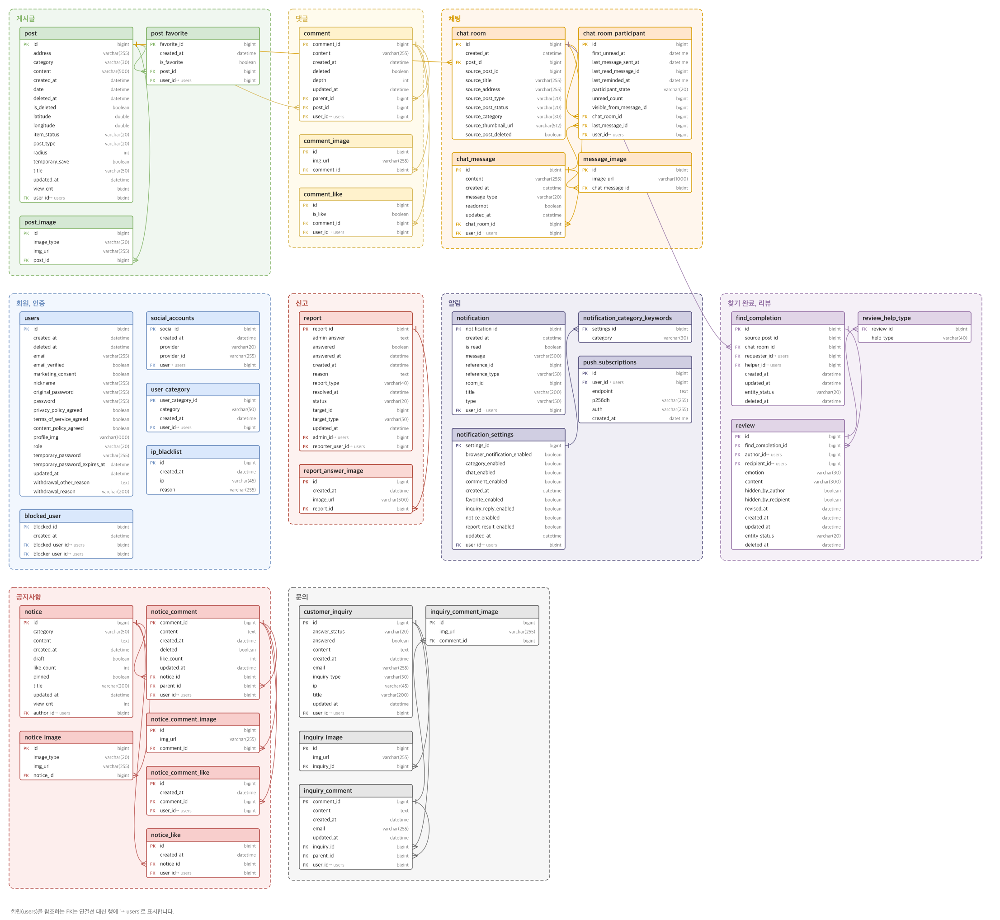

# 찾아줘! 

<p align="center">
  <a href="https://www.finditem.kr/">
    
  </a>
</p>

**배포 링크**: [https://www.finditem.kr/](https://www.finditem.kr/)

찾아줘!는 지도 기반으로 분실물과 습득물을 쉽게 찾고 공유할 수 있는 커뮤니티 서비스입니다.

경찰청 데이터와 연동하여 정보를 제공하며, 실시간 채팅과 알림 기능을 통해 잃어버린 물건을 빠르게 찾을 수 있도록 돕습니다.

## 기술 스택

| 분류 | 기술                                                     |
|---|--------------------------------------------------------|
| 언어 / 프레임워크 | Java 17, Spring Boot 3.5                               |
| ORM / DB | Spring Data JPA, QueryDSL, MySQL, Flyway               |
| 인증 | Spring Security, JWT, Redis                            |
| 실시간 | WebSocket (채팅)                                         |
| 스토리지 | AWS S3 (이미지)                                           |
| 알림 | 이메일, Web Push (VAPID)                                  |
| 모니터링 | Actuator, Prometheus, Grafana |
| 로깅 | Grafana Alloy, Loki, Logstash 포맷(JSON) |
| 인프라 / 배포 | AWS (EC2, RDS, ECR), Nginx, Docker, GitHub Actions     |
| 문서 | SpringDoc OpenAPI (Swagger)                            |

## 아키텍처

<p align="center">
  
</p>

## 주요 도메인

- **Post** — 분실물·습득물 게시글 등록 및 조회
- **Favorite** — 게시글 즐겨찾기
- **User / Auth** — 회원가입·로그인, JWT 인증
- **Map** — 지도 기반 위치 검색
- **Chat** — 채팅방·채팅 메시지 (WebSocket)
- **Comment / Like** — 댓글(게시글·공지) 및 좋아요
- **Notification** — 실시간 알림 (Web Push)
- **Report / Admin** — 신고 처리, 관리자 기능
- **Notice / Inquiry** — 공지사항, 문의

## ERD

> [바로가기](https://dbdiagram.io/d/6a5200f636d348d120bcdf20)

<p align="center">
  
</p>

## 개발 기간

- 전체 개발: 2025.08 ~ 진행 중
- 1차 MVP: 2026.04 완료
- 2차 MVP: 진행 중

## 팀 구성

<details>
<summary>1차, 2차 MVP 백엔드 멤버</summary>

<br/>

- **1차 MVP**: [세정 (Lead)](https://github.com/Yoosejeong), [찬호](https://github.com/kkch1012), [재현](https://github.com/hyeonjaez)
- **2차 MVP**: [세정](https://github.com/Yoosejeong), [상혁](https://github.com/sangcci)

</details>

## 로컬 실행

### 1. JDK 17

- SDKMAN

```bash
sdk use java <Java 17 버전>
```

- Local JDK

```bash
export JAVA_HOME=$(/usr/libexec/java_home -v 17)
export PATH="$JAVA_HOME/bin:$PATH"
```

### 2. MySQL, Redis

`local` 프로필은 `localhost:3306`의 `fmi` 데이터베이스(사용자 `fmi`, 비밀번호 `fmi`)와 `localhost:6379`의 Redis에 연결합니다. 스키마는 Hibernate가 생성하고, Flyway는 실행하지 않습니다.

```bash
docker run -d --name fmi-mysql \
  -p 127.0.0.1:3306:3306 \
  -e MYSQL_ROOT_PASSWORD=root \
  -e MYSQL_DATABASE=fmi \
  -e MYSQL_USER=fmi \
  -e MYSQL_PASSWORD=fmi \
  -v fmi-mysql-data:/var/lib/mysql \
  mysql:8.4
docker run -d --name fmi-redis \
  -p 127.0.0.1:6379:6379 redis:7-alpine
```

### 3. Git 훅 설정

최초 1회 실행하면 commitlint가 git hook으로 등록되어 커밋할 때마다 메시지 형식을 검증합니다.

```bash
npm ci
git config --local core.hooksPath .githooks
```

### 4. 환경 변수

DB, Redis와 JWT는 `application-local.yml`의 기본값으로 동작합니다. 아래 기능을 확인할 때만 환경 변수를 설정합니다. `dev`, `prod`의 값은 사용하지 않습니다.

| 기능 | 환경 변수 |
|---|---|
| Kakao 로그인 | `KAKAO_TEST_CLIENT_ID`, `KAKAO_TEST_CLIENT_SECRET`, `KAKAO_ADMIN_KEY` |
| Apple 로그인 | `APPLE_TEAM_ID`, `APPLE_CLIENT_ID`, `APPLE_KEY_ID`, `APPLE_PRIVATE_KEY_BASE64` |
| 메일 | `MAIL_USERNAME`, `MAIL_PASSWORD` |
| 문의, 신고 Slack 알림 | `SLACK_WEBHOOK_INQUIRY_URL`, `SLACK_WEBHOOK_REPORT_URL` |
| 번역 | `DEEPL_API_KEY` |

### 5. Spring Boot 실행

```bash
SPRING_PROFILES_ACTIVE=local ./gradlew bootRun
```

### 6. API 확인

실행 후 [Swagger UI](http://localhost:8080/swagger-ui/index.html)에서 API를 확인합니다.
